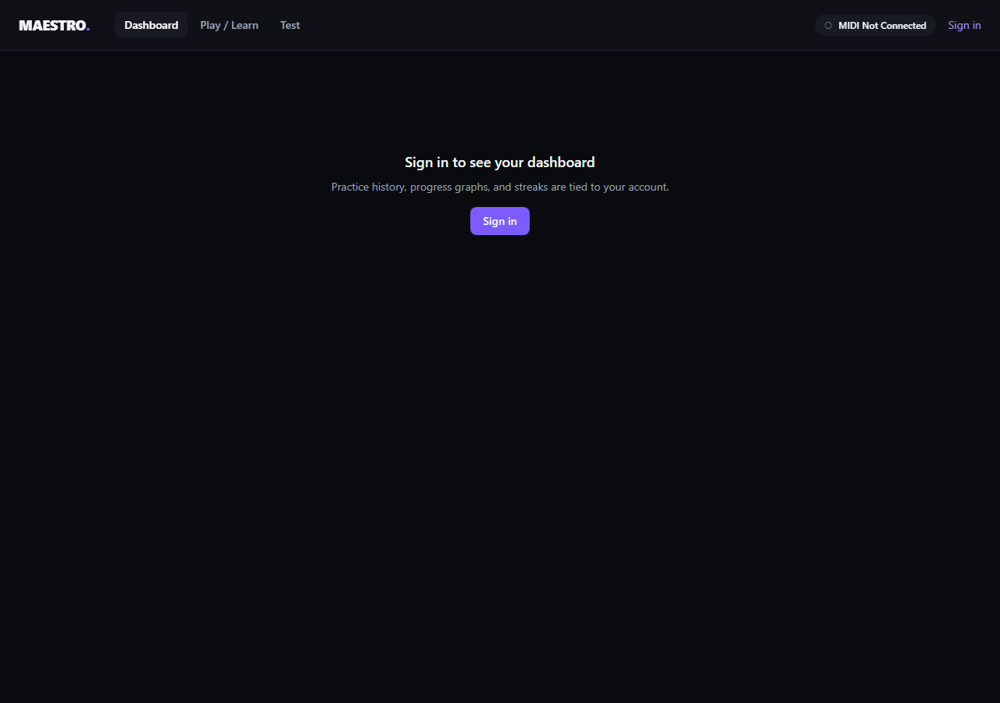

# Maestro

Maestro is a piano-learning web app that works with a physical MIDI keyboard. It provides guided practice, performance tests, and detailed feedback from live MIDI input.



## Features

- Connects USB MIDI keyboards through the browser's Web MIDI API for low-latency feedback.
- Provides Learn mode for guided note-by-note and bar-by-bar practice.
- Provides Test mode with scored performances, mistake details, and bar-level heatmaps.
- Ingests standard `.mid` files and correctly handles tempo and time-signature changes.
- Preserves raw performance events alongside derived analysis for future ML-driven coaching.
- Uses a swappable scoring-engine interface, keeping the current rule-based evaluator ready for a future ML service.

## Tech stack

| Area | Tools |
| --- | --- |
| Frontend | React, TypeScript, Vite, Tailwind CSS, Web MIDI API, Tone.js |
| Backend | Node.js, Express, TypeScript, Zod, JWT, Helmet, rate limiting |
| Data | MongoDB, Mongoose |
| Music processing | `@tonejs/midi`, tempo-aware musical-time conversion |
| Charts | Recharts |

## Architecture

```text
MIDI keyboard → Web MIDI API → event stream → live UI / recorder
                                                ↓
Reference MIDI → ingestion pipeline → MongoDB → scoring engine → feedback
```

The monorepo uses npm workspaces for the React client, Express API, and shared TypeScript contracts. The real-time MIDI path stays in-browser; performance events are persisted only after a session ends.

For a deeper design overview, see [docs/ARCHITECTURE.md](docs/ARCHITECTURE.md).

## Run locally

### Prerequisites

- Node.js 18+
- MongoDB (local, Docker, or Atlas)
- Chrome or Edge for Web MIDI support
- A USB MIDI keyboard (optional—the UI can still be explored without one)

```bash
npm install

# Configure the API
cp server/.env.example server/.env

# Optional: start MongoDB with Docker
docker run -d -p 27017:27017 --name maestro-mongo mongo:7

# Create the demo user and start both applications
npm run seed --workspace=server
npm run dev
```

- Client: `http://localhost:5173`
- API health check: `http://localhost:4000/api/health`

## MIDI library workflow

Put `.mid` or `.midi` files under `data/midi/` and run:

```bash
npm run ingest:midi --workspace=server
```

The ingestion process hashes source files, so it is safe to rerun and skips unchanged tracks.

## Verification

```bash
npm run build
```

The MIDI ingestion/time-conversion path has been exercised with a synthetic song containing mid-piece tempo and time-signature changes.

## License

This project is currently unlicensed. Add a license before reusing or distributing it publicly.
